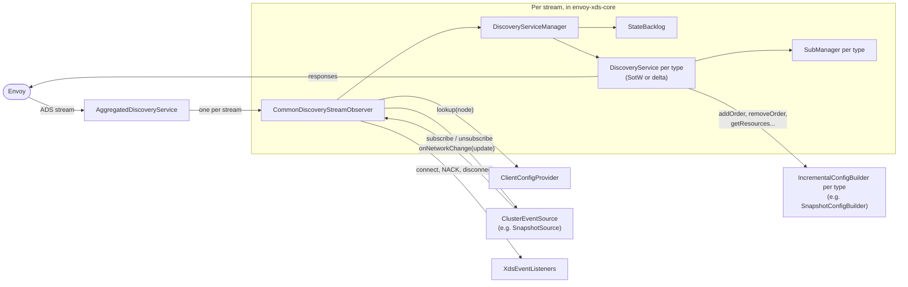
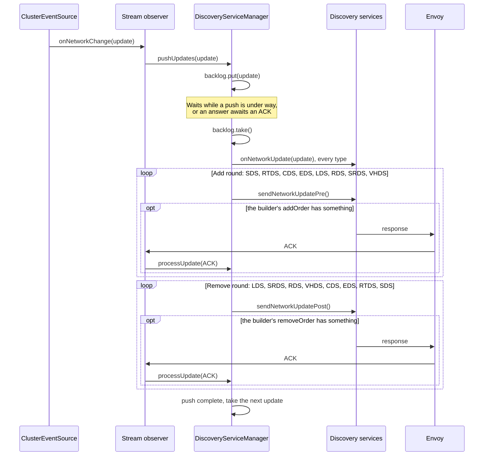

# Architecture

This is for someone about to change the library. To use it, start with [USAGE.md](USAGE.md).

## 1. Overview

envoy-xds is a Java library for the server side of Envoy's Aggregated Discovery Service (ADS): one gRPC stream per
Envoy, carrying every xDS resource type. It is not a control plane. You decide what config each Envoy should have; the
library gets it there safely.

Some terms used throughout:

- **xDS type**: a kind of resource, named by its type URL: listeners (LDS), route configs (RDS), scoped route configs
  (SRDS), virtual hosts (VHDS), clusters (CDS), endpoints (EDS, a `ClusterLoadAssignment` per cluster), secrets (SDS)
  and runtime layers (RTDS). `TypeUrl` lists the ones we serve.
- **SotW** (state of the world): each response for a type carries every resource of that type the Envoy subscribed to.
- **Delta**: each response carries only the resources that changed, and the names of those removed.
- **ACK / NACK**: Envoy answers each response with a request carrying the response's nonce. With `error_detail` it is a
  NACK: Envoy rejected the response, and keeps what it had.
- **Wildcard**: subscribing to every resource of a type rather than to names. LDS, CDS, SRDS and VHDS allow it.
- **Make before break**: a resource reaches Envoy before anything that refers to it, and leaves only after nothing does.
  A route never points at a cluster Envoy doesn't have.

You give the library three things: a **source** of state updates (`ClusterEventSource`), a **config builder** per
xDS type that turns state into resources (`IncrementalConfigBuilder`), and a **client config provider** that says what
each Envoy is (`ClientConfigProvider`). The snapshot module provides the first two for you. The library handles each
stream: subscriptions, ordering, ACKs, NACKs and reconnects.

The modules:

| Module | What it is |
|---|---|
| `envoy-xds-core` | The ADS service. `net.woaf.jono.envoy.xds` has the entry point, `XdsConfig` and `TypeUrl`; `.api` the interfaces you implement; `.api.utils` the backlogs, `SerialEventListener` and `ResyncAfterNack`. `.internal` (with `.internal.sotw` and `.internal.delta`) is the protocol machinery, and isn't API. |
| `envoy-xds-snapshot` | Snapshot-style config: publish groups of resources and views of them, and it works out what changed for each Envoy. |
| `envoy-xds-testing` | Helpers to test any Java control plane against a real Envoy, and an xDS conformance suite. It doesn't depend on core. |
| `envoy-xds-example` | A toy control plane driven from the command line, both with hand-written config builders and with snapshots. |
| `envoy-xds-e2e-tests` | Runs the conformance suite against this library on real Envoys. |
| `envoy-xds-spec-tests` | Runs the trace vectors from [envoy-xds-spec](https://github.com/JonathanO/envoy-xds-spec), a submodule at `spec/`, against this library. Tests only. |

## 2. Components

### The entry point: `AggregatedDiscoveryService`

The gRPC service you add to your server. It takes the source, the config builders, the client config provider, the
event listeners, a `StateBacklogFactory` and a supplier of metrics. From the one list of config builders it builds two
factories, one for SotW streams and one for delta, so both protocols serve the same config. It checks that each
builder's `handlesType()` is a type in `TypeUrl`, and throws if not.

For each stream Envoy opens (`streamAggregatedResources` for SotW, `deltaAggregatedResources` for delta) it creates a
`CommonDiscoveryStreamObserver`, with a fresh metrics object from the supplier. That's all it does.

### The per-stream observer: `CommonDiscoveryStreamObserver`

One per stream. It is three things at once: the gRPC `StreamObserver` that receives Envoy's requests, the
`ClusterManagerEventListener` that receives state updates from the source, and the `ClientHandle` your listeners use to
resync the stream. Its methods for requests, updates and resyncs are all `synchronized` on it, so it is the stream's
one lock: requests from gRPC and updates from the source never run at the same time.

It owns the stream's lifecycle. On the first request it looks up the client's config, tells the listeners, builds the
manager and subscribes to the source. It wraps each request in a `CommonDiscoveryRequest`, which hides the difference
between `DiscoveryRequest` and `DeltaDiscoveryRequest`. It logs and ignores a request for a type URL we don't serve,
such as ECDS: closing the stream would take every other type down with it. When the stream ends, for whatever reason,
it unsubscribes from the source, closes the manager and tells the listeners.

### The manager: `DiscoveryServiceManager`

One per stream, and not thread safe: the observer's lock guards it. It decides what is sent when, across types. It
owns:

- the change being pushed, which round it is in (add or remove), and which type's ACK it waits for;
- the `StateBacklog` of changes waiting their turn;
- the set of types whose answers to Envoy's requests await an ACK (`outstandingAcks`);
- requests held back until clusters are ACKed (`heldRequests`);
- whether the stream is frozen after a NACK;
- the client's `delayUpdatesUntilAckOf` and `subscribesTo`, and the clock for the 30 second give-up;
- the order of removals Envoy needs after it reconnects.

### The per-type services and their sub managers

The manager has one `DiscoveryService` for every type in `TypeUrl`, whether or not you gave a config builder for it.
A type with no builder gets a `NoOpConfigBuilder`, which never has any resources. Such a type still answers Envoy, with
nothing, and counts as not served (`isServed()`), so nothing waits for it.

`AbstractDiscoveryService` holds what both protocols share: the latest state update the service was given, which
round of the current change it still has to send (`SubState`: `PRE` for the add round, `POST` for the remove round,
`COMPLETED` for neither), and whether Envoy has ever asked for this type. A type Envoy never asked for never calls its
config builder. It also packs each resource into a protobuf `Any` once, keyed by the message instance, so a message
shared by many clients is serialised once.

- `delta.IncrementalDiscoveryService` sends `DeltaDiscoveryResponse`s. It awaits an ACK while its last nonce is
  unanswered. It keeps the removals it found when Envoy reconnected until the manager says they may go, and what it
  sent to answer requests while a change waited, so the change doesn't send it again.
- `sotw.SotwDiscoveryService` sends `DiscoveryResponse`s. It keeps the whole set it last sent (`resourceState`), and
  each response sends that set. Its `VersionManager` numbers versions and nonces, and ignores a request whose nonce
  isn't the latest, as the protocol says.

Each service has a **sub manager**, which tracks what Envoy subscribed to and returns a filter of the names newly
subscribed to, or nothing if there is nothing to answer. Wildcard types use a `WildcardSubManager`, the rest a
`SubListSubManager`. The wildcard ones also keep the explicit names, since a client may leave wildcard mode and expect
them to apply.

- Delta: the first request for a wildcard type with no names is a wildcard subscription. After that, `*` in the
  subscribe list starts one and `*` in the unsubscribe list ends it. A request that only unsubscribes needs no answer.
  A request that subscribes to and unsubscribes from the same name (other than `*`) is an error, and fails the stream
  with `INVALID_ARGUMENT`.
- SotW: each request lists every name wanted. For a wildcard type, an empty list means wildcard until the client has
  sent a name, and after that it means nothing. A request that only drops names isn't answered.

### The source and the backlog

A `ClusterEventSource<StateUpdT>` publishes state updates of a type you choose. Each stream subscribes once, with
`subscribe(listener, clientDetails)`, which returns the current state as an update; later updates arrive through the
listener's `onNetworkChange`. An update must let a config builder work out the whole state, and what changed: the
example's `SimpleUpdate` is the state before and after.

Each stream gets its own `StateBacklog` from the factory. Every update goes into it, and the manager takes the next one
out when it can start a push. Two come with the library:

- `MergingStateBacklog` merges updates that implement `Mergeable`. Updates that arrive while a push is under way become
  one, so a busy Envoy gets one push, not many. An update whose `mergesWithLater()` is false is kept apart from those
  after it, which is how phases work.
- `QueueingStateBacklog` keeps every update, first in first out. Its behaviour doesn't depend on Envoy's speed, which
  can be useful in tests.

### The config builders

An `IncrementalConfigBuilder<ResourceT, StateUpdT, DetailsT>` serves one type. Each method gets a predicate that says
whether Envoy subscribed to a name, and the client details from your `ClientConfigProvider`.

- `addOrder(update, ...)` and `removeOrder(update, ...)`: what a change sends in its add round and its remove round, as a
  `Response` of resources to add or replace and names to remove. New things go in the add round, removed things in the
  remove round. The builder decides which is which; some updates are in effect removals.
- `getResourcesAddOrder(state, ...)`: every resource, as it should be part way through a change: the new ones added,
  the old ones not yet removed. Used to answer requests mid-change, until this type's remove round has gone, and
  after a NACK stops the change.
- `getResourcesRemoveOrder(state, ...)`: every resource, as it should be once the change is done. Used to answer
  requests the rest of the time.
- `handlesType()`: the resource class.

If a builder returns a name Envoy didn't subscribe to, the service logs a warning.

### The snapshot module

`envoy-xds-snapshot` implements both halves for you. `SnapshotSource` is a `ClusterEventSource` of `SnapshotUpdate`s,
which holds named groups of resources (`Snapshot`s) and named views, each an ordered list of groups.
`SnapshotConfigBuilder` is an `IncrementalConfigBuilder` that compares a client's view before and after a change. See
[section 9](#9-the-snapshot-modules-design).

## 3. A stream's life

### Connecting

Envoy opens the stream, and gRPC calls `streamAggregatedResources` or `deltaAggregatedResources`, which create the
observer. Nothing else happens until Envoy's first request.

### Client config

The first request carries Envoy's `Node`: its id, cluster, metadata and so on. The observer:

1. calls `ClientConfigProvider.lookup(node)`, once per stream, on the gRPC thread, so it can read the gRPC `Context`;
2. calls each listener's `onNewClient(handle, node, config)`.

`XdsConfig` carries the client details, which your config builders get, and two options described in
[section 7](#7-reconnects).

### Subscribing to the source

Once a request for a type we serve arrives (normally the first), the observer builds the manager: a service per type,
and a backlog from the factory. Then it subscribes to the source with `subscribe(this, clientDetails)`, and initialises
the manager, and every service, with the update that returns. The services' state starts there, and each later update
follows on from it.

### How requests are processed

Each request goes to the manager's `processUpdate`, which hands it to its type's service, unless it must wait (see
[section 5](#5-requests)). The service:

1. checks whether it answers the last response: a matching nonce means an ACK, or a NACK if it has `error_detail`;
2. hands the subscription changes to its sub manager;
3. if there are newly subscribed names, answers them.

Then the manager carries on: if a change is being pushed, this might be the ACK it waits for, so it tries to send the
next type's response; if not, it starts any work that can now go.

### The end

A stream ends when Envoy closes it, when it fails, or when `ClientHandle.resync()` closes it. Either way the observer
unsubscribes from the source, closes the manager (which closes the metrics), calls each listener's
`onClientDisconnected`, then completes or fails the response stream. Requests that arrive after that are ignored.

An exception while handling a request is logged, and fails the stream. An exception while pushing an update, such as
a config builder throwing, is logged once at error with the node id, and fails the stream; it isn't passed back to the
source. Envoy gets a gRPC status: `INVALID_ARGUMENT` for a bad request, which is Envoy's fault, and `INTERNAL` with
just "xds: internal error" for anything else, which is ours. The exception itself is only logged: it may say things
about the control plane that Envoy has no need of. A client that cancels the stream (`CANCELLED`) isn't logged as a
warning.

## 4. A change

### The backlog and merging

The source calls `onNetworkChange(update)`, and the observer calls the manager's `pushUpdates`. If the stream is frozen
the update is dropped. Otherwise it goes into the backlog, and if no change is being pushed the manager looks for work
it may start. It may start only when no answer to a request awaits an ACK. Then:

1. stale removals from a reconnect go first, if any may (see [section 7](#7-reconnects));
2. if `delayUpdatesUntilAckOf` no longer holds pushes back, it takes the next update from the backlog and pushes it.

When a push finishes, it looks again. So updates that arrive during a push, or while Envoy owes an ACK, wait in the
backlog, and `MergingStateBacklog` merges them into one.

### The push rounds

First every service is given the update (`onNetworkUpdate`), which becomes its state, ready to send. Then the push has
two rounds:

1. **The add round**, in `TypeUrl.ADD_ORDER`: SDS, RTDS, CDS, EDS, LDS, RDS, SRDS, VHDS. Each service calls its
   builder's `addOrder` and sends the result.
2. **The remove round**, in `TypeUrl.REMOVE_ORDER`: LDS, SRDS, RDS, VHDS, CDS, EDS, RTDS, SDS. Each calls `removeOrder`.

After a type sends a response, the manager waits for Envoy's ACK before it moves to the next type. A type with nothing
to send, or that Envoy never asked for, is passed over at once. Once the last type of the remove round is done, the
push is complete and the next update can start.

These orders put things before what refers to them on the way in (clusters and their endpoints, then the listeners and
routes that use them), and the reverse on the way out. Parts of the order come from the xDS spec, and parts are
judgement.

What each type sends differs by protocol:

- Delta sends the added and changed resources, and the names removed. It leaves out resources it already sent, during
  this change, to answer a request (see [section 5](#5-requests)). If nothing is left, it sends nothing.
- SotW applies the round's changes to its whole set, and sends the whole set. A round with no changes sends nothing.

### Phases

Make before break follows the order of types. Some changes need an order the types can't show: a route must stop
selecting a cluster's subset before the cluster drops it, say. Those are split into phases. Each phase is a separate
update whose `mergesWithLater()` is false, so `MergingStateBacklog` never merges a later update into it, and the client
gets the whole push of one phase, ACKed, before the next starts. The snapshot module makes phases with `then()` (see
[section 9](#9-the-snapshot-modules-design)); any `Mergeable` update can do the same.

## 5. Requests

### Subscriptions are answered from current state

When Envoy subscribes to names, the type's service answers with them from the latest update it was given:

- Delta sends the newly subscribed resources, and lists in `removed_resources` the names it subscribed to that don't
  exist, so Envoy stops waiting for them.
- SotW sends its whole set, with the new names added. It answers every request that adds names, even if it has nothing
  for them: Envoy waits for an answer to its first request of each type.

If a change is under way and this type's remove round hasn't gone yet, the answer comes from `getResourcesAddOrder`:
the change's new resources, and the old ones it will remove later, so nothing goes before what may still refer to it.
Otherwise it comes from `getResourcesRemoveOrder`. Delta remembers what it answered with during the add round, and the
add round leaves those resources out if they haven't changed. SotW, whose answer is the whole set, first applies the
type's add round if it's still to send, so the answer is consistent; that round then sends nothing more. The remove
round always goes in its turn.

These answers aren't part of a push. The manager counts each as awaiting an ACK, and doesn't start a new push until
they're all ACKed. A push already under way carries on.

### Route-type requests are held while clusters are pending

Requests for LDS, RDS, SRDS and VHDS, the types that may refer to clusters, wait while a CDS or EDS response awaits its
ACK, or a change's endpoints are still to be sent (`clustersPending`). When Envoy reconnects it subscribes to
everything at once, and without this its routes could arrive before the clusters they use. Held requests are handled
in the order they came, as soon as the clusters are no longer pending.

A request isn't held if its own type awaits an ACK, so an ACK the manager waits for is never held. CDS and EDS requests
are never held: Envoy holds its CDS ACK until new clusters have warmed, which needs the EDS answer.

A NACK that is held still freezes the stream at once (see [section 6](#6-nacks)); the rest of it waits its turn.

### A request never overtakes a held one of its type

If a request of the same type is already held, a new one is held behind it, whatever else is going on. Each request of
a type follows on from the one before: delta's subscribe and unsubscribe lists are changes to the last, and SotW's
nonce must be the latest. Handling them out of order would get the subscriptions wrong.

### SotW and delta differences

| | SotW | Delta |
|---|---|---|
| A response carries | every subscribed resource of the type | changed resources, and names removed |
| An ACK | has the latest nonce, and echoes the version sent | has the latest nonce |
| A request with an old nonce | is ignored | is handled, but isn't the ACK |
| A request that only unsubscribes | isn't answered | isn't answered |
| What Envoy kept over a reconnect | isn't known: a whole-set answer replaces it | is in `initial_resource_versions`, so stale names can be removed in order |
| An answer after a NACK, for the rejected type | repeats the whole set, including what was rejected | has only the newly subscribed names |

## 6. NACKs

### Freezing

When a request carries `error_detail`, the observer logs a warning and calls each listener's `onClientNack`. Then the
manager freezes the stream, for good:

- it abandons the change being pushed: every service drops what is left of it, and the push counts as complete;
- it empties the backlog;
- it drops every later update.

It still answers new subscriptions, from the state the services last had. For a change cut short that is the change's
add round, for types it left mid-way, as their removals never went out; each answer covers only the names it adds, so
the rest of the change isn't sent. On SotW each answer is the
whole set, so for the type Envoy rejected it repeats what was rejected. Envoy rejects it again and keeps what it has.

Why freeze? A rejected change won't fix itself: resending it, or a later change that includes it, gets rejected again.
Envoy may have taken part of it, so we no longer know what it has, and diffing from what we think it has could make
things worse. Rolling back would undo whatever part Envoy took. Dropping the stream would have Envoy reconnect straight
away, get the same config, and loop. So Envoy keeps serving its last good config, which goes stale until someone acts.

### Resync

`ClientHandle.resync()` closes the stream cleanly. Envoy reconnects, and its first request on the new stream tells us
what it has, so it syncs from scratch with the config as it is now. It is safe to call from any thread, and does
nothing if the stream has already ended. Requests Envoy sent before it saw the close are ignored.

### `ResyncAfterNack`

An `XdsEventListener` that resyncs a stream a while after its first NACK. The delay starts at `initialDelay` and doubles
with each NACK after a resync, up to `maxDelay`. It goes by node id, since a resync makes a new stream, and forgets a
node once it has gone `2 * maxDelay` without a NACK. A pending resync is cancelled if the stream ends first.

## 7. Reconnects

Envoy keeps its config while it's disconnected. When it reconnects, it subscribes to everything at once. Over delta it
also sends `initial_resource_versions`: the names, and versions, of what it kept.

### Stale removals are deferred, in remove order

Over delta, a name Envoy kept that we no longer have must be removed, but not before the things that may refer to it.
When Envoy subscribes, a service may send such removals at once only if every type before it in `REMOVE_ORDER` has been
answered and isn't awaiting an ACK. Types we don't serve, and types left out of `subscribesTo`, are skipped. Otherwise
the service keeps the removals.

Kept removals go when the manager looks for work to start (see [section 4](#4-a-change)): before the next change, and
only once no answer awaits an ACK. They go one type at a time, in remove order, waiting for each type's ACK. Each type
checks again which names are still subscribed to and still missing. A change waits behind them. A name Envoy didn't
keep but subscribed to, and that doesn't exist, is answered as removed at once: Envoy has nothing to remove.

Over SotW there is no such list. A SotW CDS answer is the whole set, so a cluster Envoy kept that we no longer have goes
at once, even if a route Envoy kept still uses it. The e2e tests record this as a known deviation. Prefer delta.

### `subscribesTo`

`XdsConfig.subscribesTo` lists the types a client gets from us. Null, the default, means every type we serve. Removals
don't wait for types left out. This matters when you serve types only some Envoys use, such as SRDS or VHDS: we can't
tell an Envoy that won't ask for them from one that hasn't yet, as Envoy only asks once the listeners and routes naming
them arrive. `subscribesTo` changes only what removals, and `delayUpdatesUntilAckOf`, wait for. An Envoy asking for a
type left out still gets it.

### The 30 second give-up

`DiscoveryServiceManager.WAIT_FOR_ACK_TIMEOUT_NANOS` is 30 seconds, counted from when the stream subscribed to the
source. There is no timer: it's checked when something happens, a request or a change. Once removals have waited that
long for a type to be answered or ACKed, the manager logs a warning, and from then on that stream's stale removals no
longer wait.

### `delayUpdatesUntilAckOf`

`XdsConfig.delayUpdatesUntilAckOf` holds back pushes of changes until Envoy first ACKs an answer of that type. It works
around Envoy problems such as [envoy#16035](https://github.com/envoyproxy/envoy/issues/16035), where endpoint updates
interfere with Envoy's start up. Answers to requests, and stale removals, aren't held back. If `subscribesTo` leaves the
type out, the option is ignored, with a warning. Otherwise, after 30 seconds without that ACK, the manager logs a
warning and pushes anyway, at the next request or change.

## 8. Threading

Each stream has one lock, the observer's monitor. Everything for that stream runs under it: the manager, the services,
the sub managers, your config builders, the metrics and the listener calls. Different streams run in parallel.

Three kinds of thread take that lock:

- **gRPC threads** deliver Envoy's requests. Answering a request, and carrying on a push after an ACK, both happen
  here, so config builders run on gRPC threads too.
- **The source's thread** calls `onNetworkChange`, which starts pushes. With `SerialEventListener` (and so with
  `SnapshotSource`), that is an executor thread.
- **Any thread** may call `ClientHandle.resync()`.

`SerialEventListener` wraps a listener so a source can broadcast without calling into streams. It delivers each
listener's updates one at a time, in order, on an executor; different listeners run in parallel. By default that is a
shared pool with one daemon thread per core (`xds-update-N`): delivering an update runs config builders and hands
messages to gRPC, which queues writes, so more threads than cores wouldn't help. It doesn't merge updates; the stream's
backlog does that. If the listener throws, it gets no more updates and is closed.

A `ClusterEventSource` must avoid one deadlock. The observer holds its lock while it calls `subscribe` and
`unsubscribe`, and takes it when it gets an update. So a source must never call a listener while holding a lock that
`subscribe` or `unsubscribe` also take. Also, a stream whose update fails unsubscribes itself from inside
`onNetworkChange`, so a broadcast must tolerate the set of listeners changing under it. Wrapping each listener in a
`SerialEventListener` meets both, since a broadcast then only hands updates to an executor.

`SnapshotSource` has one lock of its own, held by `update`, `subscribe`, `group` and `view`. It hands updates to its
`SerialEventListener`s while holding it. So its executor must run tasks on other threads: with a same-thread executor,
an update would call into a stream while holding the source's lock, while that stream, subscribing, holds its own lock
and waits for the source's.

The metrics object is per stream, and only called under the stream's lock; if it writes to storage shared between
streams, it must synchronise that itself. `onNewClient` and `onClientNack` run on a gRPC thread under the stream's lock,
and `onClientDisconnected` on whichever thread ended the stream, so listeners should be quick. A listener that throws
from `onNewClient` or `onClientNack` fails the stream.

## 9. The snapshot module's design

### Groups

A group is a `Snapshot`: an immutable map from resource class to name to resource. You change one with an `Editor`
(`snapshot.edit()`), which shares every type you don't touch with the parent, and copies a type's map the first time you
edit it. The editor records the names you touched, by type. Putting a resource equal to the one there, or removing one
that isn't there, touches nothing. `put(resource)` names it as Envoy does: its `name` field, or `cluster_name` for a
`ClusterLoadAssignment`.

### Views

A view is an ordered list of group names. A client sees every resource in its view's groups; where two groups have a
resource of the same type and name, the first group's wins. The source picks each client's view with your `viewOf`
function, from the client details, when the client subscribes. Groups and views are named by keys of any type with
`equals` and `hashCode`.

A `ViewState` is a view as published at one point: its group names and the group snapshots, by reference. It builds a
merged map of a type only when something needs the whole view, such as a client connecting or a SotW answer; a change
to a few names looks them up group by group instead.

### Edits and touched names

`SnapshotSource.update(change)` collects edits in a `Change`, then applies them under the source's lock:

1. For each view whose list of groups changed, it notes that the whole view must be compared.
2. For each group changed, it notes the names touched in it, by type. Editing a group (`group(name, edit)`) touches the
   names the editor touched; replacing it (`group(name, snapshot)`) or removing it touches every name in the old and new
   contents.
3. For each view affected, it builds the new `ViewState` and a `SnapshotUpdate`: the view's previous state, its new
   state, and the names to compare (or all of them). It keeps the new state as the view's last sent.

One `SnapshotUpdate` is made per view, and shared by every client of that view.

`SnapshotConfigBuilder` compares only the names in the update, looking each up in the view before and after (protobuf's
`equals` checks identity first, so shared resources compare cheaply). In the add round it sends what is present after
and differs from before; in the remove round it removes what was present before and is gone after. Its
`getResourcesAddOrder` is the union of before and after, the after winning; its `getResourcesRemoveOrder` is the after.
As the core orders types make before break, one update is applied make before break across groups too: a cluster added
in one group arrives before the route to it in another.

`SnapshotUpdate` is `Mergeable`: merging keeps the oldest previous state and the newest current one, and the union of
the names touched. Updates must be merged in the order they were published.

### Waking only the clients a change affects

The source keeps which views each group is in, and the listeners of each view. An update is handed only to the
listeners of the views it affects. A client whose view doesn't have a changed group isn't woken at all, and one whose
view does compares only the names touched. A client whose view doesn't exist sees nothing until it's added.

A client subscribing gets an update from nothing to its view's last sent state, comparing everything. `update` and
`subscribe` take the same lock, so a client never sees part of an update.

### Phases

`Change.then()` starts a new phase, if the current one has any edits. `update` applies the phases in turn. For a view
that changes again in a later phase, it marks the update for this phase as ending a phase, so `mergesWithLater()` is
false and the backlog won't merge the next phase into it. Only clients whose view changes in a later phase wait. A
client connecting during the update gets the end result. `update` returns each changed view's update, all phases
merged.

## 10. Metrics and events

### Metrics

`AggregatedDiscoveryService` calls your `Supplier<DiscoveryServiceManagerMetrics>` once per stream. Every method has a
default that does nothing, and `DiscoveryServiceManagerMetrics.METRICS_DISABLED` supplies one that records nothing.

- `onPushBegin()` and `onPushComplete()` bracket a change's push, from taking it from the backlog to the ACK of its last
  response. A push cut short by a NACK completes too. The time between them is the push latency.
- `onAwaitingAck()` and `onMessageAcked()` count answers that await an ACK: answers to requests, and stale removals
  after a reconnect. A push's own responses aren't counted here.
- `close()` is called when the stream ends.

The e2e tests use these to tell when a stream is idle (`DiscoveryServiceManagerEventListener` in
`envoy-xds-e2e-tests`).

### Events

`XdsEventListener` has `onNewClient(handle, node, config)`, `onClientDisconnected(handle, node)`, and
`onClientNack(handle, node, typeUrl, errorDetail)`, which does nothing by default. The handle is the stream: unique
among connected streams, and the same object in every call for that stream.

### Logging

The library logs through SLF4J. At warn: NACKs, requests for unknown types, config builders returning names Envoy
didn't subscribe to, the 30 second give-ups, and stream errors other than cancellation. At error: a failed update, with
the node id. At info: closing a stream to resync it. `CommonDiscoveryStreamObserver` puts the node id in the MDC as
`node` at each entry point (a request, an update, an error or completion, a resync) and restores what was there after,
so every record under it names the client, and nothing leaks to the next client on a pooled thread.

## 11. How it's tested

- **Unit tests** in `envoy-xds-core` and `envoy-xds-snapshot`, with JUnit and Mockito.
- **Property tests** with Hegel, 1000 cases each:
  - `CommonDiscoveryStreamObserverPropertiesTest`: random requests, source changes, resyncs and failures, in any order,
    on the real stack over both protocols. A stream answers only what was asked, fails only for protocol violations,
    and always cleans up.
  - `SubManagerPropertiesTest`, for each protocol: the sub managers against a model of the spec's subscription rules.
  - `MakeBeforeBreakPropertiesTest`: random snapshot changes over the real stack, against a model of an Envoy that
    applies each response, ACKs it and subscribes as Envoy does. What it serves from must only refer to config it holds.
  - `SnapshotSourceConcurrencyTest`: clients connect, disconnect and publish on several threads at once.
- **Mutation testing**: `./gradlew pitest` must kill every mutant in `envoy-xds-core` and `envoy-xds-snapshot`, each with
  its own module's tests (`mutationThreshold = 100`). CI runs it for both modules, as part of the required check. A
  method that can't be covered would be marked `@DoNotMutate` with the reason; none are, and an exception needs the
  maintainer's agreement.
- **Fray**: `SnapshotSourceFrayTest` explores the thread interleavings of races on `SnapshotSource`, such as a client
  subscribing while an update is published. Run it with `./gradlew :envoy-xds-snapshot:frayTest`. It takes minutes, so
  it isn't part of `check`; CI runs it as a job of its own.
- **Trace vectors**: `envoy-xds-spec-tests` runs every vector in the spec submodule (`spec/vectors`), once per
  protocol, through the real `AggregatedDiscoveryService` and the snapshot module, with a fake Envoy per Envoy in the
  vector. Every port runs the same vectors, so they hold the ports to the same behaviour. The format is in the spec
  repo's docs/VECTORS.md. Clone with `--recurse-submodules`, or run `git submodule update --init`.
- **End to end, against real Envoys**: `envoy-xds-e2e-tests` runs the conformance suite from `envoy-xds-testing`
  (`EnvoyXdsConformanceTest`, through the snapshot module) on every Envoy release upstream supports, 1.36 to 1.40, over
  SotW and delta, with and without rate limiting. `ChangesDuringAPushAreMergedTest` checks that changes arriving during
  a push are merged. They need Docker; CI runs a job per Envoy version. Envoy is never mocked.

Static checks run with the build: Error Prone, and NullAway (every package is `@NullMarked`). Javadoc warnings fail CI,
but `check` doesn't run javadoc, so run `./gradlew check javadoc` before pushing.
